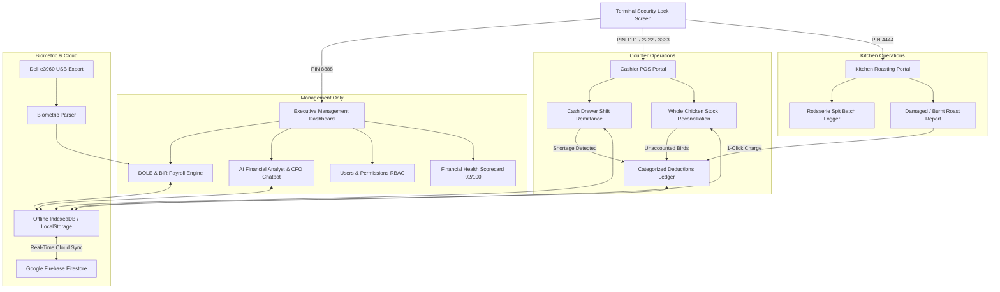

# Ron's Chicken - Custom ERP, Lechon Inventory & Payroll Suite (v4.0.8-erp)

**Business Name:** Ron's Chicken (Lechon Manok & Liempo)  
**Branch:** Cugman Branch (Cagayan de Oro City, Misamis Oriental, Philippines)  
**Clients / Owners:** Bro Irl & Sis Riza (Management) • 0928 775 6605 • [Facebook Page](https://www.facebook.com/pages/Rons-Chicken/1808066046182615) • *DHLC Church Family*  
**Developer:** Jason Jeff D. Velasquez  
**Live Deployment (Vercel):** [https://rons-chicken-payroll.vercel.app](https://rons-chicken-payroll.vercel.app)  
**1-Click Emergency Cache Reset Link:** [https://rons-chicken-payroll.vercel.app/?reset=1](https://rons-chicken-payroll.vercel.app/?reset=1)  
**GitHub Repository:** [https://github.com/jasonvelasquez1410/rons-chicken-payroll](https://github.com/jasonvelasquez1410/rons-chicken-payroll)  
**Latest Cache-Buster Version:** `v=4.0.8-erp`

---

## 1. Project Background & Objective

- **Hardware Environment:** **Deli e3960** (Standalone biometric fingerprint attendance clock, non-WiFi).
- **Core Workflow:** Staff punch in/out on the Deli e3960 at Cugman branch. Supervisor exports the attendance matrix to a USB flash drive as an Excel spreadsheet (`cugman_(August)Employee Attendance Record.xls`).
- **ERP Transformation:** Expanded the standalone payroll calculator into a full-featured, zero-cost restaurant ERP suite tailored for Cugman operations:
  1. **Terminal Security Lock Screen (RBAC):** Touch keypad and keyboard input with 4-digit PIN authentication. Roles for **Management** + **3 Cashiers** (Morning, Evening, Relief) + **Kitchen Roaster**. Staff accounts access isolated operational portals, shielding sensitive employee wage rates, DOLE payroll totals, and store margin data.
  2. **Zero Public PIN Display:** PIN numbers and bypass options are completely hidden from the public terminal UI. Only Management holds the master access codes and distributes them privately.
  3. **Interactive Conversational AI Financial Analyst ("Ron's AI CFO"):** Executive advisory chatbox that converses in **English, Taglish, and fluent Cagayan de Oro Bisaya**. Features 1-click pre-made consultation questions, scenario simulation calculators, and persistent business memory that learns new rules across sessions.
  4. **Itemized Deductions Ledger:** Categorized sections for **Utang** (Store Credit/Loans), **CA** (Cash Advance/Vale), **Shortages** (Cashier Remittance Gaps), and **Lacking Products** (Burnt/Damaged/Missing chicken accountability).
  5. **Daily Lechon Manok & Liempo Inventory Engine:** Daily stock reconciliation (Beginning display, Delivered birds, Spit Roasting Batches, Sold Whole/Half/Liempo, Spoilage, and Closing display) with real-time discrepancy alerts and 1-click auto-charge to deductions.
  6. **Cashier Sales & Shift Remittance Reconciliation:** Drawer cash count vs expected sales, GCash collection, store petty expense tracking, and automated shortage deduction charging.
- **Operating Cost:** Runs at **$0 monthly operating cost** utilizing Google Firebase Spark Free Tier (<0.05% quota usage) and Vercel edge hosting.

---

## 2. Master Access PINs & User Role Permissions

> **CONFIDENTIAL (For Management Only):**  
> PINs are hidden from all screen views, placeholders, and user cards. Management can modify PINs and permissions anytime under the **Users & Permissions** module (`[⚙️ Customize Permissions & PIN]`).

| Profile ID | Display Name | Role / Shift | Confidential PIN | Authorized Features & Permissions |
| :--- | :--- | :--- | :---: | :--- |
| `usr_admin` | **Management** | Owner & Management | **`8888`** | **Full Executive Access:** AI Advisor, DOLE Payroll, Salaries, Inventory Audit, Cloud Sync, User RBAC |
| `usr_cashier_1` | **Chailene Dolido** | Cashier 1 (Morning Shift: 06:00 - 14:00) | **`1111`** | **Cashier POS Portal:** Shift Drawer Remittances, Chicken Stock Count (Payroll & AI Blocked) |
| `usr_cashier_2` | **Pamela Galdo** | Cashier 2 (Evening Shift: 14:00 - 22:00) | **`2222`** | **Cashier POS Portal:** Shift Drawer Remittances, Chicken Stock Count (Payroll & AI Blocked) |
| `usr_cashier_3` | **Relief Cashier** | Cashier 3 (Weekend / Relief Shift) | **`3333`** | **Cashier POS Portal:** Shift Drawer Remittances, Chicken Stock Count (Payroll & AI Blocked) |
| `usr_kitchen` | **Gerald Lacasa** | Kitchen / Master Roaster (14:00 - 23:00) | **`4444`** | **Kitchen Terminal:** Rotisserie Spit Batches, Damaged Roast Loss Logs (Cash & AI Blocked) |

---

## 3. System Architecture & Component Workflow



---

## 4. Key Modules & Features Implemented

### A. Terminal Security Lock Screen (`js/erp-modules.js`)
- **Keypad & Keyboard Support:** Touchscreen 3x4 numeric keypad with clear (`⌫`), unlock (`🔓`), and physical keyboard sync (`#lock-pin-input`).
- **Auto-Unlock:** Triggers authentication automatically upon entering 4 digits.
- **Strict Authentication:** Removed all bypass buttons so staff must enter their authentic PIN.
- **Clean Naming:** Admin profile is labeled cleanly as **Management** across all selection cards and hero displays.

### B. AI Financial Analyst & CFO Advisor (`js/erp-modules.js`, `js/db.js`)
- **Multi-Lingual Conversation Engine:** Understands and replies in **English, Taglish, and authentic Cagayan de Oro Bisaya** (e.g. *pila, unsaon, ginansya, halin, trabahante, sweldo, kuwang, timan-i*).
- **1-Click Pre-Made Questions:**
  1. *Daily Break-Even Volume:* Calculates exact volume (105 whole chickens/day) needed to cover ₱15,800 daily operating overhead (31 staff wages + charcoal + gas + utilities).
  2. *15% Monthly Profit Strategy:* Algorithmic recommendations (+₱33,200/mo) via 5 PM dinner rush liempo roasting, spiced gravy add-on combos, and zero-shortage turn-overs.
  3. *Lechon Manok vs Liempo Profitability:* Comparative unit economics (₱150 margin on whole chicken vs ₱170 margin on liempo).
  4. *Cashier Shortage Mitigation:* Mandatory 2:00 PM blind drawer count protocols and automated payroll ledger integration.
  5. *31 Staff Labor Audit:* Benchmarked against DOLE Northern Mindanao standards (₱438–₱480/day + ₱50 meal allowance = ~19.8% labor cost ratio).
  6. *Raw Chicken Price Sensitivity:* Explains financial impact if supplier increases bird prices from ₱210 to ₱215–₱220.
- **Persistent Business Knowledge Memory (`rons_erp_ai_business_memory_v2`):**
  - Users can teach the AI new store rules (e.g., typing *"Take note: Friday sales surge 40%"* or *"Timan-i: ang supplier sa manok mo-deliver alas 6 sa buntag"*).
  - The AI records the fact into persistent storage and incorporates it into all future financial calculations and projections.
- **Local Simulation + Optional API Key:** Operates completely offline with built-in financial formulas, while supporting an optional Google Gemini API key if desired.

### C. Cashier POS Counter Portal (`js/erp-modules.js`)
- **Shift Drawer Remittance:** Cashiers input counted cash bills, coins, GCash digital payments, and store expense vouchers.
- **Automatic Shortage Computation:** Calculates `Variance = Counted Cash - Expected Cash`. If negative, provides a 1-click shortcut to log the shortage directly to the cashier's payroll deductions.
- **Chicken Stock Count:** Records whole birds received from kitchen roasters, sold over counter, and closing warmer display buffer.

### D. Kitchen & Roasting Portal (`js/erp-modules.js`)
- **Rotisserie Spit Batch Logger:** Records spit number (Spit 1–4), roaster name, whole chicken count, and roasting duration.
- **Damaged / Burnt Roast Reporting:** Automatically computes loss at wholesale cost (₱210/bird) and can link to employee lacking products ledger.

### E. Philippine DOLE & BIR Payroll Engine (`js/payroll-engine.js`, `js/biometric-parser.js`)
- **Biometric Processing:** Parses raw Deli e3960 Excel punch matrices for all 31 staff. Correctly handles split lunch breaks and overnight roasting shifts.
- **Statutory Deductions (SSS, PhilHealth, Pag-IBIG):**
  - Semi-monthly 50/50 split across 15th and 30th/31st cutoffs.
  - Manual overrides and 1-click exemption checkboxes.
  - TRAIN Law tax-exempt status for minimum wage earners.
- **1-Click Batch Payslip Generator:** Single-line locked headers formatted for standard paper or thermal receipt printing.

### F. Multi-Device Real-Time Cloud Sync (`js/firebase-sync.js`)
- Google Firebase Firestore integration (`rons-chicken-payroll`).
- Seamless real-time updates across phone, laptop, and counter tablet.
- Fully resilient offline-first mode (automatic sync upon reconnection).

---

## 5. File & Directory Reference

```
📁 Ron's Chicken Custom Payroll System/
├── 📄 project.md                                       # Master project documentation & resume notes
├── 📄 README.md                                        # Git & setup guide
├── 📄 Rons_Chicken_Custom_Payroll_Proposal_Quotation.html # Single-page formal proposal source
├── 📄 Rons_Chicken_Custom_Payroll_Proposal_Quotation_v2.pdf # Print-ready single-page proposal PDF
├── 📄 index.html                                       # Application shell (PWA) with v4.0.8-erp cache busters
├── 📄 manifest.json                                    # PWA manifest
├── 📄 sw.js                                            # Service Worker (Self-destruct & cache purge script)
├── 📄 vercel.json                                      # Vercel deployment & strict cache headers
├── 📄 cugman_(August)Employee Attendance Record.xls    # Real Deli e3960 attendance sample
├── 📁 assets/
│   └── 🖼️ logo.jpg                                     # Ron's Chicken official logo
├── 📁 css/
│   └── 🎨 style.css                                    # Bento Grid, Theme Dimmer & Print CSS (v4.0.8-erp)
└── 📁 js/
    ├── ⚙️ db.js                                        # Persistent DB, Auto-Backups, 31 Staff Profiles, SafeStorage
    ├── ⏱️ biometric-parser.js                          # Deli e3960 Excel parser & timecard engine
    ├── 💰 payroll-engine.js                            # DOLE/BIR statutory calculation engine & semi-monthly split
    ├── 🍗 erp-modules.js                               # ERP Suite: Inventory, Remittances, RBAC, Lock Screen & AI CFO
    ├── ☁️ firebase-sync.js                             # Real-time multi-device cloud synchronization (Firestore)
    ├── 📡 device-sync.js                               # Hardware USB config & Cloud push API
    └── 🚀 app.js                                       # Cutoff controller, views, payslips & UI router
```

---

## 6. Commercial Terms & Quotation Reference

- **Total One-Time Project Investment:** **₱30,000.00**
  - Custom Payroll & Biometric Engine (Lifetime Ownership, $0 monthly fees): **₱25,000.00**
  - Deployment, Onboarding, 1st Cutoff Assistance & 30-Day Warranty: **₱5,000.00**
- **Milestone Payment Terms (50% / 50%):**
  - **Milestone 1 (50% - ₱15,000.00):** System Delivery, UAT Access & Demo Acceptance
  - **Milestone 2 (50% - ₱15,000.00):** Completion of 1st Live Cutoff Payroll Run & Final Turnover

---

## 7. 🚀 WHAT TO DO NEXT AFTER LAPTOP RESTART (Quick Resume Checklist)

When you turn on your laptop and resume work:

1. **Open the Project Folder in IDE:**
   - Workspace directory: `c:\Users\USER\Documents\Programming Folder Rep\Ron's Chickent Custom Payroll System`.

2. **Verify Live Production Deployment:**
   - Open: [https://rons-chicken-payroll.vercel.app](https://rons-chicken-payroll.vercel.app).
   - Check the terminal lock screen: It should display **Management** as the primary admin profile with PINs completely hidden.
   - Enter **`8888`** to unlock executive mode.

3. **In Case of Stale Browser Cache on Client Devices:**
   - Have the client visit: [https://rons-chicken-payroll.vercel.app/?reset=1](https://rons-chicken-payroll.vercel.app/?reset=1).
   - This automatically executes storage purge, clears old service workers, and reloads `v4.0.8-erp` cleanly.

4. **Client Collaboration (Bro Irl & Sis Riza):**
   - Forward the ready-to-send Christian update message via Messenger.
   - Guide them to log in with Management PIN `8888` and try chatting with the AI Financial Analyst or clicking the pre-made question buttons.
   - Assist in uploading their latest USB biometric file (`.xls`) from the Deli e3960 when their next cutoff arrives.
